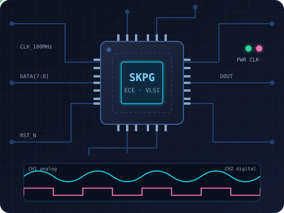

<!-- ============================== HEADER ============================== -->
<p align="center">
  
</p>

<p align="center">
  <a href="https://github.com/SujithPG-coder">
    
  </a>
</p>

<p align="center">
  <a href="https://www.linkedin.com/in/sujithkrishnapg/"></a>
  <a href="https://doi.org/10.1109/IATMSI68868.2026.11465218"></a>
  <a href="https://github.com/SujithPG-coder?tab=repositories"></a>
  
</p>

---

<!-- ============================== ABOUT ============================== -->
<table>
  <tr>
<td valign="top" width="55%">

## ⚡ About Me

```verilog
module SujithKrishnaPG (
    input  wire curiosity,
    input  wire coffee,
    output reg  [7:0] innovation
);
    // B.Tech ECE
    parameter FOCUS  = "EV | Automotive | VLSI";
    parameter ALSO   = "Embedded | Networking | DSP";
    parameter LANGS  = "C | C++ | Python | SQL | Verilog";
    parameter IEEE   = "FFT architecture @ IATMSI'26";
    parameter MOTTO  = "From schematic to silicon";

    always @(posedge curiosity or posedge coffee)
        innovation <= innovation + 1;
endmodule
```

</td>
<td align="center" valign="middle" width="45%">

</td>
  </tr>
</table>

- 🎓 **B.Tech in Electronics & Communication Engineering** at **Amrita Vishwa Vidyapeetham, Coimbatore** 
- 🚗 Industry internships in the **automotive and EV sectors** at **Pricol Limited** and **L&T EduTech**
- 📄 Published author in **IEEE Xplore**: power- and area-optimized FFT hardware architectures
- 🔬 Hands-on across **EV modelling, automotive electronics testing, FPGA/RTL design, analog circuits and data analysis**
- 🎯 Aiming to build my career in **network and business development**

---

<!-- ============================== EXPERIENCE ============================== -->
## 💼 Experience

<table>
  <tr>
    <td width="18%" align="center" valign="top">
      <br/>
      <sub><b>May 2026 – Jun 2026</b><br/>Chennai</sub>
    </td>
    <td valign="top">
      <h3>Engineering Intern · L&amp;T EduTech</h3>
      <ul>
        <li>Built and validated <b>MATLAB/Simulink electric-vehicle models</b> under multiple drive-cycle conditions</li>
        <li>Learned how large-scale infrastructure projects are planned and executed, and the engineering practices behind them</li>
      </ul>
      
      
      
      
    </td>
  </tr>
  <tr>
    <td width="18%" align="center" valign="top">
      <br/>
      <sub><b>Apr 2026 – May 2026</b><br/>Coimbatore</sub>
    </td>
    <td valign="top">
      <h3>Electronics Engineering Intern · Pricol Limited</h3>
      <ul>
        <li>Observed manufacturing and assembly of <b>automotive instrument clusters</b> and <b>fuel pump control modules</b></li>
        <li>Tested and verified the quality of <b>TFT display modules</b> used in automotive instrument clusters</li>
        <li>Saw <b>robotic automation</b> in use for electronic assembly, inspection and production</li>
      </ul>
      
      
      
      
    </td>
  </tr>
</table>

---

<!-- ============================== PUBLICATION ============================== -->
## 📄 Publication

<table>
  <tr>
    <td width="18%" align="center" valign="middle">
      <a href="https://doi.org/10.1109/IATMSI68868.2026.11465218"></a><br/>
      <sub><b>IATMSI 2026</b><br/>Gwalior, India</sub>
    </td>
    <td valign="top">
      <h3><a href="https://doi.org/10.1109/IATMSI68868.2026.11465218">Power and Area Optimized FFT Architecture Through Multiplier-Level Hardware Design</a></h3>
      Presented at the <i>IEEE International Conference on Interdisciplinary Approaches in Technology and Management for Social Innovation (IATMSI 2026)</i> and published in <b>IEEE Xplore</b>.<br/><br/>
      Implemented FFT architectures with <b>Wallace-tree, Vedic and Booth multipliers</b> in Xilinx Vivado and compared their power, delay and hardware use. The <b>Wallace-tree FFT</b> had the lowest delay and the lowest total on-chip power (<b>0.334 W</b>), while the Vedic FFT gave a balanced trade-off.<br/><br/>
      
      
      
      
      <a href="https://doi.org/10.1109/IATMSI68868.2026.11465218"></a>
    </td>
  </tr>
</table>

---


<!-- ============================== PORTFOLIO ============================== -->
## 🗂️ Portfolio

<p align="center">
  Explore my work across <b>FPGA / VLSI design</b>, <b>digital logic</b>, <b>analog circuits</b>, <b>signal processing</b> and <b>machine learning</b>.
</p>

<p align="center">
  <a href="https://github.com/SujithPG-coder?tab=repositories">
    
  </a>
</p>

---

<!-- ============================== SKILLS ============================== -->
## 🧰 Tech Arsenal

<p align="center">
  
</p>

<div align="center">

**Languages**<br/>


**Hardware Design, EDA & Simulation**<br/>


**Embedded & Networking**<br/>


**Data & ML**<br/>


**Domain Knowledge**<br/>
`Electric Vehicles` · `Automotive Electronics` · `Quality Testing` · `Data Analysis` · `Digital System Design` · `Analog Circuits` · `DSP` · `Computer Networks` · `PCB Design`

</div>

---

<!-- ============================== CERTIFICATIONS ============================== -->
## 🏆 Certifications

<table>
  <tr>
    <td width="50%" valign="top" align="center">
      
      <h4>Cisco Certified Network Associate (CCNA)</h4>
      <sub>Completed: <b>Introduction to Networks</b> · <b>Switching, Routing &amp; Wireless Essentials</b></sub>
    </td>
    <td width="50%" valign="top" align="center">
      
      <h4>NPTEL: Python for Data Science (Elite)</h4>
      <sub>NumPy · Pandas · basic machine-learning workflows</sub>
    </td>
  </tr>
</table>

---

<!-- ============================== STATS ============================== -->
## 📊 GitHub Analytics

<p align="center">
  
</p>
<p align="center">
  
</p>

---

<!-- ============================== CONTRIBUTIONS ============================== -->
## 🎮 Contribution Graph

<p align="center">
  <picture>
    <source media="(prefers-color-scheme: dark)" srcset="https://raw.githubusercontent.com/SujithPG-coder/SujithPG-coder/output/pacman-contribution-graph-dark.svg">
    <source media="(prefers-color-scheme: light)" srcset="https://raw.githubusercontent.com/SujithPG-coder/SujithPG-coder/output/pacman-contribution-graph.svg">
    
  </picture>
</p>

---

<!-- ============================== FOOTER ============================== -->
<p align="center">
  <i>"Turning ideas into circuits, and circuits into silicon."</i>
</p>

<p align="center">
  
</p>
